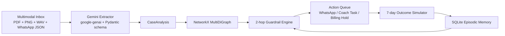

# PitchPulse AI: Multimodal Knowledge Graph & Intervention Agent

PitchPulse AI is a runnable MVP that demonstrates enterprise **Predict → Decide → Act** workflows for retention and revenue protection using multimodal signals.

Even though this demo is framed around a youth football academy, the architecture maps directly to B2B scenarios where fragmented evidence (documents, messages, audio, images) must be converted into guardrailed interventions.

## What this MVP includes

- Deterministic synthetic data seeding (`python seed_data.py`) with:
  - Real PDFs (`fpdf2`)
  - Real PNG tactical/match diagrams (`Pillow`)
  - Real WAV audio evidence (`wave`)
  - WhatsApp JSON logs, attendance logs, baseline roster
  - Pre-computed `cached_extractions.json`
  - Pre-populated SQLite episodic memory (`outcomes.db`)
- Dual execution mode in Streamlit:
  - **⚡ Instant Cached Demo Mode** (sub-50ms local retrieval)
  - **🔴 Live Gemini 2.5 Flash API** via modern `google-genai` SDK
- Knowledge graph + 2-hop cross-signal guardrails
- Editable action queue + closed-loop simulation and learning

## Architecture



## Run locally

```bash
pip install -r requirements.txt
python seed_data.py
streamlit run app.py
```

Open the Streamlit URL and choose one of the 3 hero scenarios.

## Docker (Hugging Face Spaces compatible)

```bash
docker build -t pitchpulse-ai .
docker run -p 7860:7860 pitchpulse-ai
```

## Business framing

- **Predict:** fuse weak signals across channels into quantified risk profiles.
- **Decide:** apply cross-signal guardrails to prevent harmful automations.
- **Act:** execute channel-specific interventions and learn from outcomes.

This is the core pattern for reducing churn, protecting collections, and increasing expansion revenue in high-friction service businesses.
